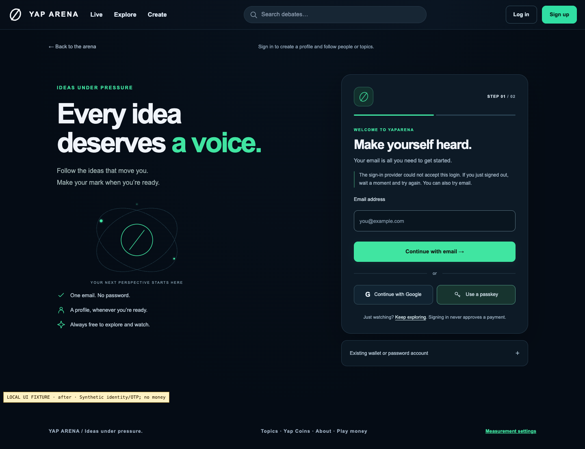

# Passkey sign-in error classification — 2026-10-21

Source change: **3096ca776a04f3cf38ad835d7348329791c0385b**. Overall account
and financial task remains incomplete; this correction enables no live money.

The installed Privy SDK can fail before its completion callback. Previously every
such failure was described as cancellation or no matching passkey, including a
provider403, outage, throttling, initialization error or interrupted connection.
The correction retains cancellation guidance for the SDK's actual cancellation/
no-match codes and gives bounded retry/email guidance for the other failures.
No raw provider message is exposed and no identity, cookie, proof or authorization
rule changes. The genuine user's first failed returning attempt has an unknown
cause; this independently reproduced defect is not asserted to explain it.

## Controlled reproduction and installed-SDK acceptance

The [before diagnostic](sdk/before-provider-denied-desktop.json) proves the old
behavior for one synthetic provider403: init1, authenticate0, application exchange0,
old cancellation notice visible, expected provider notice absent. The final
verifier ran against baseline frontend `99c37480…` and bundle `14a61184…`, exited
one at the expected assertion and captured the correctly labeled before image.
An earlier raw reproduction had the default after watermark and stays private;
it is not substituted for this matching pair.
The RED diagnostic contains counts/booleans rather than an embedded source/asset
manifest. Its baseline source independently matches Git5e; the recorded baseline
build's bundle is also corroborated by the earlier hosted eba asset receipt.
The complete source/asset manifest belongs to GREEN and is not relabeled as RED.

| Before                                                                                               | After                                                                             |
| ---------------------------------------------------------------------------------------------------- | --------------------------------------------------------------------------------- |
|  |  |

The [final installed-SDK browser result](sdk/browser-results.json) passed
**125 unique checks**, zero page errors and zero requirement failures: the
existing111 plus seven desktop and seven mobile pre-completion paths. These
cover403,503,429, invalid app initialization, unknown failures, connection failure
and a real Chromium virtual authenticator without a matching key. Each checks
the bounded notice, retry availability, hidden signed-in state, zero authenticate/
app-exchange calls and no private provider detail. The
[mobile screenshot](sdk/after-provider-denied-mobile.png) was inspected separately.
The shared theme/header/layout are preserved in the matching fixtures.

The result starts at base5e5f107 plus exact source hashes subsequently committed
as3096ca7. Frontend SHA256
`554f8bff0da7be8426dfea0297421dbbc5e4a46acc4f2d0a4632b97a7dfd38e4`,
verifier
`ce97c3cfaab4dde356ec0b86110704838c99470cafea460c1102077b5b44a881`,
bundle
`e739af3b12c31d92d26a7f5f7046a51eef4e2bd45e152fed5ecd6e3bd9545c15`.
All eight recorded sources and17 assets matched both root and isolated checkout.
Strict TypeScript, ESLint and formatting passed for the final fixture.

The first candidate build failed because the installed package declares an enum
that its browser entry point does not export. The corrected build uses verified
SDK wire strings. The first GREEN then found a test expectation error: Privy's
transport has three retries for503/network failures, so there are exactly four
init attempts;403/429/400 have one. Independent execution of installed ofetch
with no network verified those exact counts. The final fixture preserves exact
counts and all zero-auth/exchange/privacy assertions; no broad count range or
weakened authorization assertion was introduced.

Reproduction uses the maintained strict TypeScript SDK verifier with explicit
`PRIVY_APP_ID`, `AUTH_BROWSER_ARTIFACT_DIR`, `AUTH_BROWSER_PHASE` and optionally
`AUTH_BROWSER_PUBLIC_DIR`. Only the public app metadata is fetched. The fixture
disables CAPTCHA in its intercepted metadata and supplies synthetic OTP/provider/
application responses; it does not replace the working hosted integration.
No genuine email delivery, Google/provider login, provider wallet creation,
physical-device or complete WCAG acceptance follows from this suite.

## Combined local repository gate

The [new combined result](integrated/result.json) and [run log](integrated/run.log)
record build, disposable fresh/upgrade isolation and all four coordinator steps:
**858 tests, zero skips**, coverage **95.32/91.22/95.35**. Each fresh/upgrade path
passed239 account/security/ledger,17 A4 and five treasury cases. The
[retained-wallet fixture](integrated/retained-wallet.json) passed four groups,
including its authoritative refresh barrier and final-method protection.
[Database logs](integrated/database/quality.log),
[A4](integrated/a4.json), [arena](integrated/arena.json),
[shared discovery](integrated/shared-bots.json),
[homepage](integrated/homepage.json) and [preview](integrated/live.json)
retain their narrower assertions and synthetic limits.

The combined gate started at5e plus the frozen frontend source above; the
independent SDK fixture's final retry-count correction was checked and run
separately. The combined coordinator does not execute that SDK harness. Exact
committed-tree CI remains a separate result. Earlier separate native18, coin22,
cookie7/14 and real-Redis trials were not rerun or promoted by this frontend edit.
The first combined attempt stopped at the enum build failure; a second built but
local PostgreSQL shared memory was sandbox-blocked. The permitted third invocation
passed using its disposable native cluster, never a staging database. Its owned
cluster, app/browser fixtures and processes exited cleanly.

## Genuine acceptance and release boundaries

The separate [genuine user and read-only evidence](../embedded-wallet-release/genuine-passkey-wallet-20261021/README.md)
records successful setup/later passkey login, user-only wallet ownership and a
persisted exact native proof/audit/terms/reservation match. Those are actual
hosted scopes, not inferred from the SDK fixture. Zero hosted grant events means
grant predicates do not establish genuine issuance. Default wallet recovery,
remaining genuine journeys and provider/device/live gates remain open.

Release evidence is recorded under `release/`; exact deployed revision, readiness
and hosted guest acceptance must be observed separately from an accepted deploy
request. The earlier eba schema release and its security/backup records remain
unchanged. This frontend correction requires no database migration, provider
repair, wallet creation, account deletion or change to live financial settings.

All five exact-tree CI jobs passed in [run39690075806](https://github.com/Boufe/YapArena/actions/runs/39690075806);
the [independent CI review](ci-review.md) verifies actual checkout merge/tree,
858/zero skips and its separate runner-local acceptance. On staging,
[deploy acceptance](release/render-deploy-accepted.json) was followed by
[actual Render LIVE inspection](release/render-live.json) at exact3096ca7,
deployment `dep-dbckm30473hc739catvg`. The replay worker stayed at unchangedfd60543,
auto-deploy off, with deterministic sandbox still web-only. No schema/configuration
change or writer suspension was needed for this frontend release.

The [hosted guest trial](release/guest/acceptance.json) subsequently passed seven
groups and all14 exact served-asset hashes, readiness/private route/focus/history/
mobile checks and one bounded retired-registration Redis probe. The verifier's
asset hash evidence is separate from the control-plane commit identity. Its
first attempt stopped before asset requests because two local compiled hash
inputs were missing in the isolated release checkout; supplying those unchanged
inputs allowed the maintained verifier to run. No code assertion was changed.
The [desktop](release/guest/account-desktop.png) and
[mobile](release/guest/account-mobile.png) screenshots preserve the shared layout;
they contain no signed-in identity or credential ceremony. These guest results
do not establish genuine provider authentication, wallet recovery, hosted Redis
outage/topology, physical-device or full WCAG conformance.
